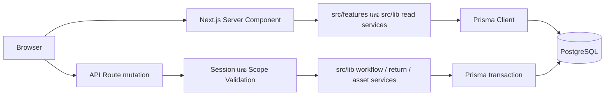
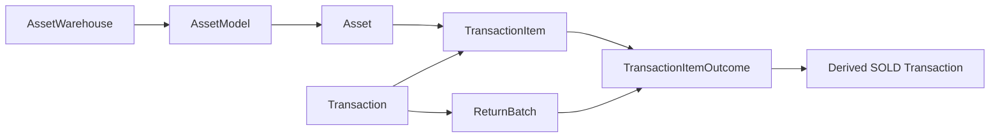

# Design: Warehouse Management System

สถาปัตยกรรมและความสัมพันธ์ข้อมูลในเอกสารนี้อ้างอิง `prisma/schema.prisma`, API routes และ server-side services ใน `src/` กฎธุรกิจอยู่ใน [PRD](prd.md) และ [Rules](rule.md)

## 1. Architecture

Next.js 15 / React / TypeScript / Tailwind CSS, PostgreSQL และ Prisma
Server Components อ่านข้อมูลจาก PostgreSQL ผ่าน lib; Client Components เรียก API สำหรับ mutation และใช้ Router สำหรับ filter navigation
CSV/SharePoint เป็น import input เท่านั้น
Authentication ใช้ signed HttpOnly session cookie, AD หรือ Local Admin; ดู [Emergency Local Login](emergency-local-login.md)

หน้าอ่านข้อมูลผ่าน Server Component และ server-side service ได้โดยตรง ส่วนคำสั่งเปลี่ยนข้อมูลเข้าผ่าน API Route ซึ่งตรวจตัวตน สิทธิ์และ Warehouse scope บนเซิร์ฟเวอร์ก่อน mutation

Workflow แยก Domain Modules โดยคง `src/lib/workflow.ts` เป็น Re-export Facade และ Transaction Boundary เดิม ส่วน UI คืนสินค้าแยก Hook และ Inline Panels ดู [Workflow Module Map](workflow-modules.md)

## 2. โมเดลหลัก

| กลุ่ม | Prisma Models |
| --- | --- |
| Users/Auth | User, Role, UserRole, UserOrganizationAssignment, LoginThrottle, LoginAudit |
| Warehouses/Permission | AssetWarehouse, WarehouseManagerAssignment, UserWarehousePermission |
| Product Master | AssetCategory, AssetType, AssetModel, Location |
| Custom Fields | AssetCategoryCustomField, AssetCustomFieldValue |
| Stock | Asset, AssetReservation, AssetStatusHistory, UserFavorite |
| Project | Project, ProjectMember, ProjectApproval, ProjectLeadChange |
| Request/Approval | Transaction, TransactionItem, TransactionApproval |
| Return | ReturnBatch, TransactionItemOutcome, ReturnOutcomeCheck, ReturnBatchEvidence |
| Import Audit | MigrationBatch, MigrationRow |

| Entity | ความรับผิดชอบ | ความสัมพันธ์หลัก |
| --- | --- | --- |
| `AssetModel` | ตัวตนรุ่นสินค้า ชื่อ ยี่ห้อ ประเภท และ `isSerialized` | อยู่ใน Warehouse; มี Asset หลายรายการ |
| `Asset` | ตัวสินค้า Serial หรือแถว Quantity Pool พร้อม Stock Code, condition, status และ on-hand | อ้าง AssetModel และ Warehouse |
| `Transaction` | คำขอ BORROW/USING/SOLD, ผู้ขอ, Project และสถานะงาน | มี Items, Approvals และ ReturnBatches |
| `TransactionItem` | Asset ที่ขอและ `requestedQuantity`; `dispatchedAt` ระบุการจ่าย | อ้าง Transaction และ Asset/Model |
| `TransactionItemOutcome` | จำนวนและผลที่ปิดการถือครองในแต่ละรอบคืน | อ้าง TransactionItem และ ReturnBatch; SOLD เชื่อม Derived Sale |

`Asset -> Transaction` เชื่อมผ่าน `TransactionItem` ไม่ใช่ foreign key ตรงจาก Asset; `ReturnBatch` กำหนดรอบและ revision ส่วน `ReturnOutcomeCheck` กับ `ReturnBatchEvidence` เก็บผลตรวจและหลักฐานของรอบ

## 3. Stock และ Identity

AssetModel บอกชนิดสินค้า ส่วน Asset บอก Serial/Condition/Warehouse/Stock Code/On-hand
Tracking จริงใช้ getEffectiveAssetTrackMethod: Model Serialized และมี Serial เป็น SERIAL; กรณีอื่น QUANTITY
โหมด SERIAL ใช้เมื่อ `AssetModel.isSerialized` และ Asset มี `serialNo`; กรณีอื่นเป็น QUANTITY ตาม [asset-tracking.ts](../src/lib/asset-tracking.ts)
Quantity stock มี NEW/USED condition buckets; RETURN/USED ใช้ Stock Code ที่ตรวจสอบกับ model/warehouse
การจับคู่ข้อมูลนำเข้ากับรุ่นและสภาพสินค้าต้องอ้างหลักฐานและสิทธิ์ที่กำหนด ไม่เทียบชื่อคล้ายแล้วโยกยอดอัตโนมัติ

Availability:
- Serial: READY, ไม่มี open transaction และตรวจ lock ตาม flow
- Quantity: assetQuantity ลบ draft reservation และ open transaction quantity ที่ยังไม่ dispatched
- จ่าย Quantity ลด stock จริงและมี dispatchedAt; return เพิ่มเมื่อ Final Gate ครบ
- ใช้ serializable transaction, row/advisory locks และ guarded updates ในจุดสำคัญ; conflict แจ้ง CONCURRENT_UPDATE/409 ให้ refresh/retry ไม่อ้างว่ามี retry อัตโนมัติทุก endpoint

ให้ `issued` เป็นจำนวนที่จ่าย, `resolved` เป็นจำนวน Outcome ที่ Post แล้ว และ `pending` เป็น Outcome ในรอบคืนที่ยังมีผล:

| ค่าที่คำนวณ | นิยาม |
| --- | --- |
| `IN_USE` | `issued - resolved` |
| `Open Quantity` | `requestedQuantity - resolved - pending` สำหรับรายการที่จ่ายแล้ว |
| `Reserved` | `AssetReservation` ที่ยังมีผล + open TransactionItem ที่ `dispatchedAt = null` |
| `Available` | `max(0, assetQuantity - Reserved)` สำหรับ Quantity Pool |

การจ่าย Quantity ลด `assetQuantity` และตั้ง `dispatchedAt` ในการ Post เดียวกัน รายการที่จ่ายแล้วจึงไม่อยู่ใน Reserved อีก ดู [asset-availability.ts](../src/lib/asset-availability.ts) และ [workflow.ts](../src/lib/workflow.ts)

## 4. Requests / Approval / Acknowledgment

buildApprovalCandidates ใน workflow.ts:
1. Requester confirmation sequence 1 สร้างตอนบันทึก
2. Project request เพิ่ม LEAD_PROJECT
3. เพิ่ม Supervisor เมื่อ requester staff-tags เข้ากฎ; จึงอาจมีทั้ง Lead และ Supervisor ในคำขอเบิก
4. STOREMAN:<warehouse> ทุกคน/คลังใน sequence เดียว ต้องผ่านครบ
5. SOLD เท่านั้นเพิ่ม BSD_STAFF

Acknowledgments ใช้ ACK_BSD / ACK_WAREHOUSE_MANAGER, sequence 999 และแยกออกจาก gate/completion
Approval เก็บ assigned user, current cycle/revision และ snapshots; Project Lead reassignment รักษาประวัติที่อนุมัติแล้ว

## 5. Return Architecture

ReturnBatch เป็นรอบคืน ไม่ใช่ Derived Return Transaction ใหม่สำหรับทุก READY outcome
ReturnBatch มี requestNo, revision, state, damagePdf และ signedPdf; ReturnBatchEvidence เก็บหลักฐาน revision เก่า
TransactionItemOutcome อ้าง item/batch/asset ที่ลงสต๊อกจริง พร้อม outcomeStatus, returnCondition, quantity และ approvedAt
ReturnOutcomeCheck เก็บการตรวจราย outcome/user

Routing คืน:
- Project -> Lead; non-project -> Supervisor ตาม buildReturnApprovalCandidates
- RETURN_CHECK:<warehouse> -> เอกสารเมื่อมี FAIL/LOST/USED -> STOREMAN:<warehouse>
- READY/USED/FAIL/LOST Post แบบ atomic หลัง final gates ครบ
- SOLD อยู่ใน Derived Transaction อ้าง sourceTransactionId และ outcome soldTransactionId รอ BSD_STAFF
- Derived SOLD ถูกสร้างและเชื่อม Outcome ตอน Submit ReturnBatch; การ Post ขายรอ Approval ของรอบคืนและ BSD Staff
- Source completion คำนวณจำนวนที่ resolve แล้ว ไม่ใช่เพียงมี pending outcomes ครบ
- ห้าม auto-approve ข้าม manual check/evidence/final storeman/price
- หลักฐานอยู่ PostgreSQL Bytes; PDF render ใช้ Chrome/Edge headless และ Thai font ตาม environment

ReturnBatch.state เป็น String และมีค่าที่ใช้ใน runtime เช่น SUBMITTED, REJECTED, CANCELLED, COMPLETED; ไม่สร้าง Workflow enum จากคำอธิบาย phase ในเอกสาร
UI RETURN -> outcomeStatus READY; USED -> READY + returnCondition USED; NEED_CHECK เป็น AssetStatus แต่ไม่ใช่ตัวเลือกในรอบคืน

## 6. Numbers / Status / Pricing

REQ-YYYYMMDD-XX ใช้วันที่ Asia/Bangkok, advisory lock, นับ Transaction + ReturnBatch รายเดือนสูงสุด 99
Derived SOLD transactionNo ว่างได้และแสดง From Source REQ; id/UUID ใช้ relation/URL ไม่ใช่ Display Request No.
Business status: BORROWED, RETURNED, USING, COMPLETED
Workflow status: PENDING, REJECTED, CANCELLED, IN_PROGRESS, COMPLETED

salePriceGroups เก็บ quantity/unitPrice/total ต่อกลุ่ม; soldPrice/soldTotal เก็บ Decimal(12,2) ตามระดับ Transaction/Item
Server normalize unit price, คูณ/รวมด้วย BigInt หน่วยสตางค์ และไม่เชื่อ totals ที่ส่งจาก Client
Client Group Total/Grand Total เป็น read-only derived values; Save Draft อนุญาตยังไม่ครบราคา แต่ Approve ต้องครบ

## 7. Frontend Primitives

- SearchCombobox: selection/Enter submit search; Clear q โดยคง hidden filters
- InstantFilterForm: GET query navigation ผ่าน Router, เปลี่ยน filter แล้ว auto-apply และ reset page
- SearchableDropdown: auto-submit เฉพาะ form ที่ประกาศ instant filters ไม่ส่งฟอร์ม Add/Edit ทันทีเมื่อเลือกค่า
- useDismiss: จัด Outside Pointer/Escape สำหรับ Columns, Side Sheet และเมนูที่เชื่อม hook; Portal มี refs แยก
- Side Sheet คงเปิดเมื่อ checkbox เปลี่ยน ไม่มี Apply; parent checkbox คุม child ทั้งกลุ่ม
- project-label / transaction-reference / readable-note / used-return-remark รวมรูปแบบที่นำไปใช้แล้ว; ยังมีบางหน้ารอเก็บ formatting ต่อ
- Project Name ในตาราง Project แสดงชื่ออย่างเดียว จุดรวม Project อื่นใช้ Customer-Projectname (ID)
- UI สีแบรนด์ #FE7743 / #EFEEEA / #273F4F / #000000; ห้ามเปลี่ยน Status palette เพราะการปรับเอกสาร

## 8. API

รายการ Methods ด้านล่างอ้าง export จริงของ route.ts ไม่อนุมาน GET จากชื่อ Resource

| Route | Methods |
| --- | --- |
| /api/assets | POST |
| /api/assets/[id]/recommendation | PATCH |
| /api/assets/[id] | PATCH, DELETE |
| /api/assets/[id]/status | PATCH |
| /api/auth/login | POST |
| /api/auth/logout | POST |
| /api/auth/me | GET |
| /api/favorites | GET, POST |
| /api/inventory/export | GET |
| /api/projects | POST |
| /api/projects/[id]/approve | POST |
| /api/projects/[id]/reject | POST |
| /api/projects/[id] | PATCH, GET, DELETE |
| /api/requests/hold | POST |
| /api/requests/release | POST |
| /api/settings/signature | POST |
| /api/transactions/pending | GET |
| /api/transactions | POST |
| /api/transactions/[id]/approve | POST |
| /api/transactions/[id]/cancel | POST |
| /api/transactions/[id]/items | POST |
| /api/transactions/[id]/items/[itemId]/return | POST |
| /api/transactions/[id]/items/[itemId]/swap | GET, POST |
| /api/transactions/[id]/pdf | GET |
| /api/transactions/[id]/reject | POST |
| /api/transactions/[id]/return | POST, DELETE |
| /api/transactions/[id]/return-batches/[batchId]/cancel | POST |
| /api/transactions/[id]/return-batches/[batchId]/check | GET, POST, PATCH |
| /api/transactions/[id]/return-batches/[batchId]/document | GET |
| /api/transactions/[id]/return-batches/[batchId]/signed-document | GET, POST |
| /api/transactions/[id] | GET, PATCH |
| /api/transactions/[id]/sale-price-draft | POST |
| /api/users | POST |
| /api/users/verify-ad | POST |
| /api/users/[id]/assignment | PATCH |
| /api/users/[id] | PATCH, DELETE |
| /api/users/[id]/status | PATCH |
| /api/warehouses | POST |
| /api/warehouses/[code]/categories | PUT |
| /api/warehouses/[code] | PATCH, DELETE |

## 9. File Structure และเส้นทางอ่านโค้ด

| ตำแหน่ง | หน้าที่ |
| --- | --- |
| [`src/app`](../src/app) | URL, Server Components และ API Routes |
| [`src/features`](../src/features) | หน้าและ UI ตามงาน เช่น Inventory, Request Cart, Transaction Log และ Return |
| [`src/lib/workflow.ts`](../src/lib/workflow.ts) | สร้างคำขอ Approval และ Stock Post ภายใน Prisma transaction |
| [`src/lib/asset-availability.ts`](../src/lib/asset-availability.ts) | Reservation และ Available |
| [`src/lib/return-batch-service.ts`](../src/lib/return-batch-service.ts) | ตรวจ Outcome และจัดการข้อมูล/เอกสารรอบคืน |
| [`src/lib/sale-price-groups.ts`](../src/lib/sale-price-groups.ts) | Validate และคำนวณราคาเป็นหน่วยสตางค์ |
| [`src/lib/auth.ts`](../src/lib/auth.ts) / [`src/lib/permissions.ts`](../src/lib/permissions.ts) | Session และสิทธิ์ตาม Role/Warehouse |
| [`src/lib/transaction-export.ts`](../src/lib/transaction-export.ts) / [`src/lib/transaction-pdf.ts`](../src/lib/transaction-pdf.ts) | ชุดเอกสารและการเรนเดอร์ PDF |
| [`prisma/schema.prisma`](../prisma/schema.prisma) / [`prisma/migrations`](../prisma/migrations) | โมเดลข้อมูลและ SQL migrations |

เส้นทางอ่านตัวอย่าง: Browser -> `src/app/dashboard/...` -> `src/features/...` -> `src/lib/warehouse-inventory.ts` -> Prisma

เส้นทางเขียนตัวอย่าง: Browser -> `src/app/api/transactions/[id]/approve/route.ts` -> `src/lib/workflow.ts` -> Prisma transaction -> PostgreSQL
