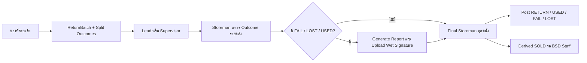

# PRD: Warehouse Management System

ข้อกำหนดผลิตภัณฑ์นี้อธิบายระบบที่กำหนดโดย `prisma/schema.prisma` และโค้ดใน `src/` อ่านโครงสร้างข้อมูลและตำแหน่งโค้ดใน [Design](design.md) และ invariants ใน [Rules](rule.md)

## 1. ขอบเขต

Warehouse Management System (WMS) จัดการสินค้าหลายคลัง ตั้งแต่ทะเบียนรุ่นและยอดพร้อมเบิก การจองและคำขอ การอนุมัติ การจ่าย การคืนบางส่วน การขาย เอกสาร และประวัติการเคลื่อนไหว PostgreSQL เป็นแหล่งข้อมูล runtime ที่ Next.js เข้าถึงผ่าน Prisma

**Hybrid Inventory Model:** `AssetModel.isSerialized` ระบุว่ารุ่นรองรับ Serial แต่ Asset เป็น `SERIAL` เฉพาะเมื่อ `isSerialized = true` และมี `serialNo` จริง หากไม่มี Serial ให้ใช้ `QUANTITY` และนับด้วย `assetQuantity` แม้รุ่นกำหนด `isSerialized = true` การติดตามแบบ Serial มีจำนวนหนึ่งต่อ Asset; Quantity Pool เก็บจำนวนในแถวสต๊อก

**สภาพสินค้า:** `Asset.condition` เป็น `NEW` หรือ `USED` แยกจาก `Asset.status` ซึ่งบอกสถานะการใช้งาน สินค้า Quantity ที่คืนเป็น USED เข้าคลังในสถานะ `READY` และ condition `USED`

## 2. ผู้ใช้และบริบท

| บทบาท/บริบท | สิทธิ์และหน้าที่ |
| --- | --- |
| ADMIN | จัดการผู้ใช้ คลัง Master Data และ Project ตาม Server permission; ไม่ได้เป็นผู้ขอเดิมโดยอัตโนมัติ |
| STOREMAN | จัดการ/ตรวจ/อนุมัติในคลังที่ได้รับมอบหมายตาม canManage |
| USER | ดูและส่งคำขอตามสิทธิ์ อนุมัติได้เมื่อมี assignment ที่ตรง |
| Organization Assignment | หลายตำแหน่งต่อ User โดยระบุ Active/Primary และระดับองค์กร |
| Project Member | LEAD_PROJECT / TEAM_MEMBER เป็นบริบทของ Project |
| Warehouse Manager | กำหนดรายคลัง มีงานรับทราบ ไม่ใช่ Final Approval Gate |

บัญชี AD ต้อง Verify Email ก่อน Save; Local Admin ฉุกเฉินตั้งรหัสผ่านนอกฟอร์ม AD

## 3. สินค้าและคลัง

- Warehouse/Category/Type/Custom Fields อ่านจากฐานข้อมูล รองรับ Dynamic Warehouse ไม่จำกัด Server/Network
- โหมดติดตามสินค้าคำนวณจาก `AssetModel.isSerialized` และ Serial Number ของ Asset
- SERIAL = Model Serialized และมี Serial; ติดตามรายชิ้นจำนวน 1
- QUANTITY = Model ไม่ Serialized หรือ Asset ไม่มี Serial; จำนวนเต็มบวกในคำขอ ใช้ assetQuantity เป็น On-hand
- NEW/USED เป็น AssetCondition; USED รับกลับเป็น READY และอยู่ใน Quantity bucket ตาม condition
- AssetStatus: READY, REQUEST, BORROW, USING, SOLD, FAIL, LOST, NEED_CHECK
- ห้ามลบ Asset ผ่าน business workflow; Administrative deletion ใช้ guard/soft delete ตาม implementation
- Prefix คลังไม่แก้หลังสร้าง; การลบคลังต้องตรวจ dependency และ active assets
- Stock Code ที่สร้างใหม่ใช้ Warehouse/Category/Type prefixes และ sequence; Stock Code ที่มี Transaction อ้างอยู่ต้องรักษาความสัมพันธ์
- Brand/Part No./Location ใน Add Asset รองรับเลือกค่าที่มีและสร้างค่าใหม่ตามรูปแบบข้อมูลของแต่ละ field

## 4. คำขอและยอดสต๊อก

- USING เป็น Internal; BORROW/SOLD เลือก Service หรือ Project อย่างใดอย่างหนึ่ง
- Cart จอง Serial ด้วย lock และ Quantity ด้วย AssetReservation
- ก่อนจ่าย: Available หัก draft reservations และคำขอเปิดที่ยังไม่ dispatched
- จ่าย Quantity แล้ว: ลด On-hand และบันทึก dispatchedAt; ไม่หักจำนวนที่จ่ายแล้วซ้ำจาก On-hand
- ทุกคลังที่เป็น Gate ต้องผ่านก่อน Post แบบ atomic ไม่จ่ายแยกเพียงเพราะคลังหนึ่งอนุมัติแล้ว
- SERIAL จัดสรรตามสิทธิ์ก่อนจ่าย; หลังจ่ายไม่เปลี่ยน Serial ใน Flow คืน

## 5. Approval Gates

Requester Confirmation เป็น sequence 1; ขั้นอนุมัติเริ่ม sequence 2

- คำขอ Project เพิ่ม Lead ที่มีสิทธิ์ของ Project ขณะนั้น
- คำขอเบิกอาจเพิ่ม Supervisor ต่อจาก Lead เมื่อ requester มี staff-tag ที่เข้ากฎ แม้เป็น Project; ไม่เขียนเหมารวมว่า Lead หรือ Supervisor เท่านั้น
- Storeman ทุกคน/ทุกคลังที่ถูกกำหนดต้องผ่านตาม all-required
- SOLD เพิ่ม BSD_STAFF หลัง Storeman เพื่อราคาและอนุมัติขาย
- Warehouse Manager และ BSD มีงานรับทราบแยก (`ACK_WAREHOUSE_MANAGER`, `ACK_BSD`) ไม่เป็น Approval Gate สำหรับการจ่าย
- ACK_BSD และ ACK_WAREHOUSE_MANAGER เป็นงานรับทราบแยก ไม่ขวาง Post/Completion
- Approval ตรวจ assigned user, current step, Warehouse permission และ signature; เก็บ snapshots/history
- ไม่ขยาย auto-approve ไปข้าม manual check, document, Final Storeman หรือ price gate

| Transaction / Flow | Requester | Lead Project | Supervisor | Storeman | BSD Staff |
| --- | --- | --- | --- | --- | --- |
| BORROW / USING | Submit และยืนยันขั้นแรก | อนุมัติคำขอ Project | อนุมัติเมื่อ staff-tag เข้ากฎ | ทุกคนในทุกคลังที่เกี่ยวข้อง; ครบแล้วจึง Post | รับทราบแยกจาก gate |
| SOLD จากคลัง | Submit และยืนยันขั้นแรก | อนุมัติคำขอ Project | อนุมัติเมื่อ staff-tag เข้ากฎ | ทุกคนในทุกคลังที่เกี่ยวข้อง | กำหนดราคาและอนุมัติขาย |
| ReturnBatch ของ Project | ผู้ขอต้นทางสร้างรอบคืน | อนุมัติรอบคืน | ไม่มี Supervisor gate | ตรวจ Outcome รายคลังและ Final Approval | รับทราบแยกจาก gate |
| ReturnBatch ที่ไม่ใช่ Project | ผู้ขอต้นทางสร้างรอบคืน | ไม่มี Lead gate | อนุมัติตาม Organization Assignment | ตรวจ Outcome รายคลังและ Final Approval | รับทราบแยกจาก gate |
| Derived SOLD จากคืน | ระบุ SOLD ใน Outcome | ผ่านขั้นของรอบคืน | ผ่านขั้นของรอบคืน | ผ่านขั้นของรอบคืน | กำหนดราคาและอนุมัติรายการขาย |

Approval ของ Storeman ดำเนินการแยกตามคลัง แต่ Post รายการทั้งหมดพร้อมกันใน Prisma transaction หลังผู้อนุมัติที่จำเป็นครบทุกคน การอนุมัติคลังเดียวไม่ตัดหรือรับสต๊อกบางส่วน

## 6. Reject / Edit / Cancel

- Reject ต้องมีเหตุผล เก็บประวัติและคืน reservation/lock ตามประเภท
- PENDING แก้ได้โดย requester ก่อนมี Approval สำเร็จ sequence มากกว่า 1
- REJECTED แก้และส่งใหม่เลขเดิมได้ แม้มี Approval รอบเก่า; rebuild current approvals โดยไม่ลบ audit เดิม
- เพิ่มสินค้าเข้า rejected request เดิมได้ตาม availability/authorization
- Cancel มี backend/UI แล้ว รักษาเลขและประวัติ ไม่คืนเลขให้คำขออื่น
- การแก้หรือยกเลิกรอบคืนและ Derived SOLD ต้องตรวจ revision, approval และ posting ของรอบนั้น

## 7. Return Batch และ Derived SOLD

- เฉพาะ requester เดิมเริ่มคืน Borrow/Using ที่เปิดอยู่ได้
- รอบคืนใช้ ReturnBatch พร้อม requestNo/revision/state และ Outcome แยกจำนวน
- UI: RETURN, SOLD, FAIL, LOST; QUANTITY เพิ่ม USED ได้ ส่วน Serialized ห้าม USED
- `NEED_CHECK` เป็น AssetStatus ของ Inventory ไม่ใช่ตัวเลือกในรอบคืน
- คืน Project ใช้ Lead; กรณีไม่ใช่ Project ใช้ Supervisor ตามเงื่อนไขใน `buildReturnApprovalCandidates`
- ต่อด้วย RETURN_CHECK ของแต่ละคลัง, เอกสารเมื่อมี FAIL/LOST/USED, แล้ว Final Storeman ทุกคลัง
- รอบที่มีเพียง RETURN/SOLD ไม่บังคับ Condition Report เพียงเพราะเป็น SOLD
- RETURN/USED รับเข้าคลังเมื่อ Final Gate ครบ; FAIL/LOST ไม่เพิ่ม Ready stock
- Quantity รับตามสินค้ารุ่น/คลัง/Stock Code ที่ผ่าน validation; ใช้ condition bucket เดิมถ้ามี ไม่ออก Stock Code ใหม่เอง
- Non-SOLD Post พร้อมกัน; SOLD รอ BSD ใน Derived Transaction แยก ไม่ตัด On-hand ต้นทางซ้ำ
- Derived SOLD ถูกสร้างและเชื่อม Outcome ตอน Submit ReturnBatch; การอนุมัติขายรอ Return Gate ที่จำเป็นผ่านก่อน
- Source ปิดเมื่อทุกจำนวน resolve สำเร็จ ไม่ใช่แค่ Submit Outcome ครบ

| ผลคืน | Serial | Quantity Pool |
| --- | --- | --- |
| RETURN | Asset รายชิ้นกลับเป็น READY | เพิ่ม on-hand ใน bucket NEW ที่ผ่านการตรวจ Stock Code |
| USED | ไม่รองรับ | เพิ่ม on-hand ใน bucket USED ที่ผ่านการตรวจ Stock Code |
| FAIL / LOST | บันทึกผลและปิดการถือครอง | บันทึกผลและไม่เพิ่ม READY on-hand |
| SOLD | Derived Sale รอ BSD | Derived Sale รอ BSD; ไม่หัก on-hand ที่จ่ายแล้วซ้ำ |

การขายตรงจากคลังเป็น Transaction `SOLD` ที่ผ่าน Requester, Lead/Supervisor ตามบริบท, Storeman ทุกคลัง และ BSD Staff ซึ่งกรอกราคาและอนุมัติก่อน Post การขายจากสินค้าที่เบิกแล้วเริ่มจาก Outcome `SOLD` ในรอบคืน และใช้ Derived SOLD ที่เชื่อมคำขอต้นทางและ Outcome

## 8. เลขคำขอ สถานะ และราคา

- REQ-YYYYMMDD-XX: วันที่ Asia/Bangkok, sequence รายเดือนรวม Transaction และ ReturnBatch สูงสุด 99
- รอบคืนใหม่มี REQ ใหม่; revision/resubmit เดิมคงเลข; Derived SOLD แสดง From เลขต้นทางและไม่มี running ใหม่
- TransactionWorkflowStatus: PENDING, REJECTED, CANCELLED, IN_PROGRESS, COMPLETED
- Business status: BORROWED, RETURNED, USING, COMPLETED; USED ไม่ใช่ Business/Workflow status
- ReturnBatch.state เป็น String ไม่ใช่ Enum Workflow เดียวกับ Transaction; ดูค่าที่ใช้งานใน Design
- BSD Staff กรอกราคาต่อกลุ่ม รองรับ Split Price, ลบกลุ่มและ Save Draft
- Group Total = quantity × unit price; Grand Total = ผลรวมกลุ่ม คำนวณ Server ด้วยหน่วยสตางค์ เก็บ Decimal(12,2)
- Draft อาจมีราคาที่ยังไม่ครบ แต่ Approve ต้องครบและจำนวนรวมตรง; ไม่เชื่อยอดรวมที่ Client ส่งมา

## 9. หน้าจอและเอกสาร

| เอกสาร | เงื่อนไขและข้อมูล |
| --- | --- |
| ใบยืม - คืน อุปกรณ์ (Unified Form) | แสดงคำขอ BORROW/USING และรอบคืน พร้อมรายการ จำนวนและลายเซ็นตามขั้นที่เกี่ยวข้อง |
| ใบขาย | แสดงรายการ SOLD จำนวน ราคาต่อหน่วย และยอดรวม; Derived Sale แสดงการอ้างอิง Source REQ ในชุดเอกสารต้นทาง |
| Condition Report | ReturnBatch ที่มี FAIL, LOST หรือ USED ต้องตรวจ Outcome ครบและ Upload PDF ลงนามแบบ wet signature ก่อน Final Storeman Approval |

- รูปแบบ Project รวม: Customer-Projectname (ID); ตาราง Project Management คอลัมน์ Project Name แสดงชื่ออย่างเดียว
- Asset History มี Request link และ Customer / Project; การแสดง Note/Remark ใช้รูปแบบอ่านง่ายในหน้าที่เชื่อม `readableNote`
- Remark USED อ้าง Source Request โดยไม่ทับหมายเหตุเดิม; ไม่สร้างข้อมูลต้นทางขึ้นเองเมื่อไม่มีหลักฐาน
- Search: เลือก suggestion/Enter ค้นหา, X ล้าง q แต่คง filters, Dropdown auto-apply, Parent Checkbox เลือก/ปลดลูก
- Side Sheet เปิดต่อให้เลือก ไม่มี Apply; Click Outside/Escape ปิดเมนูที่เชื่อม behavior ส่วนกลาง
- มี Transaction PDF, Condition Report, Signed PDF และ Excel export
- Signed PDF ผู้ Login ทุกคนเปิดดูได้; Check/Generate/Upload/Approve ยังต้องผ่านสิทธิ์
- Signed PDF สูงสุด 10 MiB; จำกัด multipart body ก่อน parse และตรวจ file.size ก่อนอ่าน ArrayBuffer
- เก็บเอกสารหลักฐานตาม revision ของ ReturnBatch

## 10. Authentication

AD และ Local Admin เป็นคนละโหมด ไม่มี fallback อัตโนมัติ; ดู [Emergency Local Login](emergency-local-login.md)
